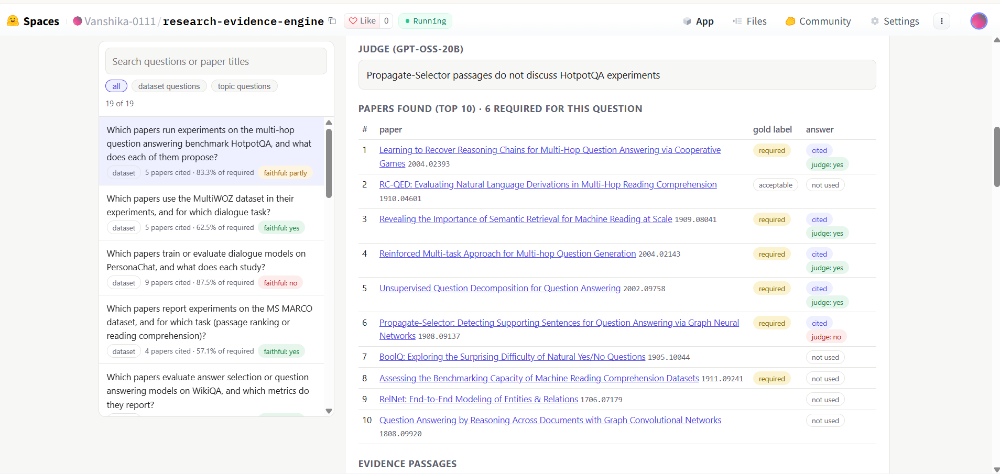
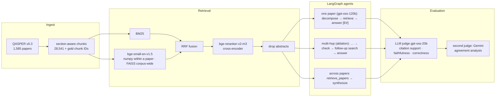
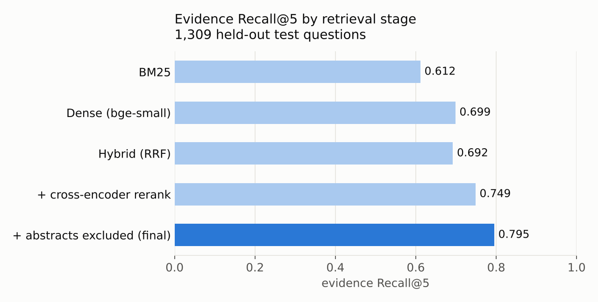
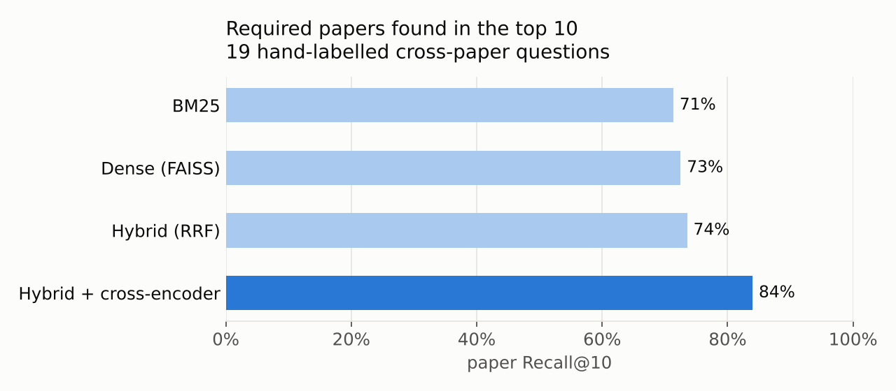
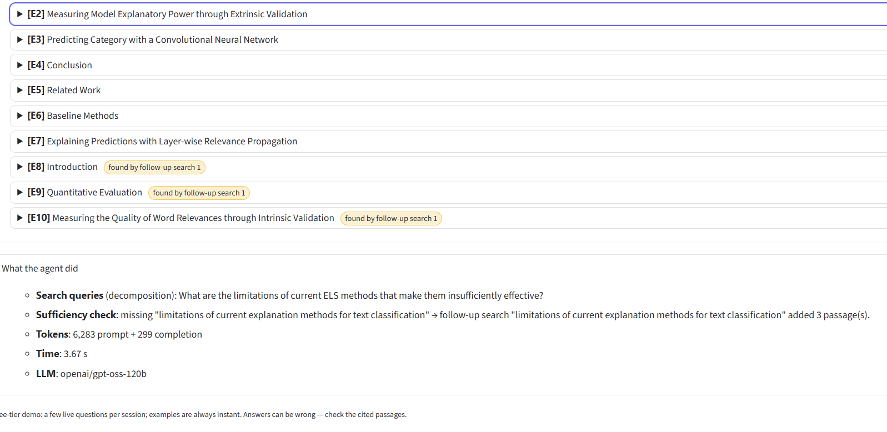
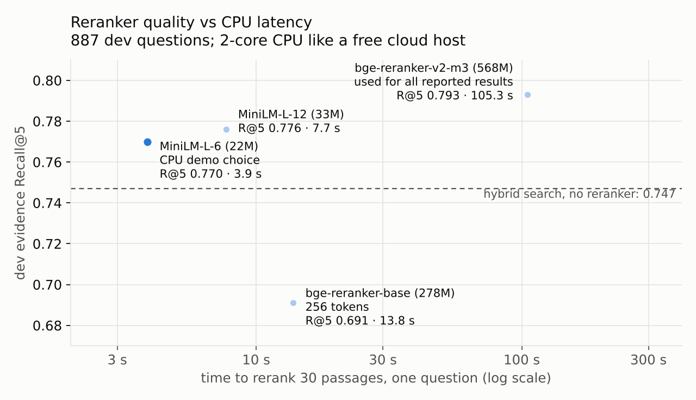

# Agentic Research & Evidence Synthesis Engine

[](https://github.com/Vanshika-0111/Research-engine/actions/workflows/tests.yml)
[](https://huggingface.co/spaces/Vanshika-0111/research-evidence-engine)

Question answering over **1,585 NLP research papers** (QASPER) where every claim cites the passage it comes from.
A retrieval stack built for scientific text (section-aware chunks, BM25, dense embeddings with FAISS, cross-encoder
reranking) feeds **LangGraph agents** that decompose questions, answer within one paper or across many, and are
evaluated with an **LLM-as-judge pipeline validated against a second model family**.

**[Browse every evaluated answer →](https://huggingface.co/spaces/Vanshika-0111/research-evidence-engine)**
(clickable citations, QASPER gold passages and the judge's verdict on each citation) · **[Full report →](REPORT.md)**

| target | result (held out, chosen on dev, test run once) |
|---|---|
| evidence Recall@5 > 75% | **0.795** on 1,309 test questions (BM25 0.612) |
| citation accuracy > 85% on 100 research queries | **95.6%** LLM-judged (72.6% strict vs QASPER gold), 100 test questions |
| faithfulness / answer correctness | **96.9%** / **83%** (LLM judge, 100 test questions) |
| cross-paper evidence aggregation | **84%** of required papers retrieved in the top 10 (BM25 71%); **98%** of cited papers correct |
| LLM-as-judge validity | **82%** verdict agreement with a judge from another model family (Gemini); headline numbers use the stricter one |
| multi-hop retrieval | built and ablated on dev: **no gain** at +46% tokens, so the single-pass agent stays the default |
| robustness to false premises | asked about the **wrong paper**, the agent declines **28 of 30** (93%); on matching questions it declines only 3% |
| token efficiency | **~3.0k tokens / question** (2 LLM calls); full table [below](#token-efficiency) |



## Architecture



## Results

### Retrieval (within the question's paper)



| split | n | system | R@5 | R@10 | hit@1 | MRR@10 |
|---|---|---|---|---|---|---|
| dev | 887 | BM25 | 0.628 | 0.875 | 0.226 | 0.429 |
| dev | 887 | Dense (bge-small-en-v1.5) | 0.711 | 0.897 | 0.356 | 0.537 |
| dev | 887 | Hybrid RRF | 0.710 | 0.904 | 0.345 | 0.532 |
| dev | 887 | + bge-reranker-v2-m3 | 0.748 | 0.934 | 0.356 | 0.550 |
| dev | 887 | + abstracts excluded | 0.793 | 0.943 | 0.466 | 0.631 |
| **test (held out)** | **1,309** | **final pipeline** | **0.795** | **0.941** | **0.522** | **0.677** |

What drove the choices (all on dev): the cross-encoder added +3.8 R@5 (bge-reranker-base gave none); none of the
gold evidence is in abstracts, yet the reranker ranked an abstract first for 31% of questions, so abstracts are
dropped after reranking (+4.5); prepending the paper title to the reranker query hurt; fp16 reranking keeps recall
identical at ~5× the speed (262 ms/question on a T4). Test was run once at the end: 0.795 vs 0.793 on dev.

### One-paper agent (100 random held-out test questions)

`decompose → retrieve → answer`: the question is split into up to 3 search queries; the question's own top 5
passages always go in first (anchored merge, which fixed a recall loss from naive fusion of sub-query results),
sub-query results fill up to 7 passages (E1–E7); gpt-oss-120b answers only from them and cites `[E#]` after every
claim. Labels are mapped back to chunk IDs, so each citation can be scored.

| metric | test, n=100 | dev, n=50 |
|---|---|---|
| **citation accuracy (LLM-judged: the cited passage supports the sentence)** | **0.956** | 0.879 |
| citation precision, strict (cited chunk is QASPER's gold chunk) | 0.726 | 0.628 |
| faithfulness (all claims supported) | 0.969 | 0.878 |
| answer correctness, all / answered only | 0.830 / 0.856 | 0.680 / 0.756 |
| evidence recall of the 7 passages | 0.848 | 0.912 |
| declined | 0.03 | 0.10 |

Strict precision undercounts: QASPER marks one gold paragraph per fact while other passages often state it too (a
manual review of the dev misses found most were valid support). Both numbers are reported. Every one of the 100
answers, with its verdicts, is browsable in the [explorer](https://huggingface.co/spaces/Vanshika-0111/research-evidence-engine).

### LLM-as-judge validation

The judge (gpt-oss-20b) is from the same family as the agent, so a second judge from another family (Gemini 3.6
Flash) graded the same 50 dev answers: **82% exact agreement** on correctness, faithfulness and citations. In 14 of
the 15 disagreements gpt-oss-20b was the *stricter* judge, and on the 8 disagreements with an independent manual
verdict it matched the human on 6. Headline numbers therefore use the stricter judge; Gemini's are an upper bound.
Re-running the same agent also showed a **run-to-run noise floor of about ±10 points** in answer correctness at
n=50, so small single-run differences are not over-read.

### Cross-paper agent (19 hand-labelled questions)



QASPER questions always belong to one paper, so 19 multi-paper questions were written and labelled by hand before
any cross-paper system existed (10 "which papers run experiments on dataset X", 9 topic questions; 145 required
papers). `retrieve_papers` searches all 28.5k chunks (BM25 + FAISS, RRF, cross-encoder over the top 100) and
groups them into the top 10 papers × 2 passages; `synthesize` writes one cited bullet per relevant paper.

| metric | v1 (first run) | v2 (prompt revised after v1 error analysis) |
|---|---|---|
| required papers shown to the LLM (retrieval ceiling) | 0.840 | 0.840 |
| required papers cited in the answer | 0.634 | 0.657 |
| cited papers that are correct (required or acceptable) | 0.984 | 0.979 |
| citation support (judge) | 0.910 | **0.990** |
| faithfulness (judge) | 0.816 | 0.816 |

v1 is the untuned result; v2 is not held out. v2 stopped claims taken from paper *titles* rather than passages
(citation support 0.91 → 0.99) but not the main weakness: answers stop at about five papers and skip roughly 1 in
4 required papers they were shown. A per-paper map-reduce node is the structural fix (future work).

### Multi-hop ablation (dev, same 50 questions)

A `check` node reads the evidence and, if a specific piece is missing, writes one follow-up search (up to 3 new
passages, E8–E10); decompose/retrieve/answer are unchanged, so any difference comes from the hop.

| | single pass (v2) | multi-hop |
|---|---|---|
| evidence recall | 0.912 | 0.925 |
| answer correctness (judge) | 0.68 | 0.77 |
| agent tokens / question | 3,070 | 4,485 (+46%) |
| searched again | – | 40% |

The correctness gain is **not** from the hop: **0 of 20** hopped answers cite a passage the follow-up search
found, and correctness rose *more* on the 30 questions that did not search again (0.767 → 0.867) than on those
that did. First-pass recall is already above 0.9, so the check mostly asks for details the paper does not contain.
The single-pass agent stays the default; multi-hop is an option (`--multihop`, app switch).



### Token efficiency

From `python -m eval.token_report` (tokens include gpt-oss-120b's hidden reasoning):

| system | split | LLM calls / q | agent tokens / q | judge tokens / q | agent tokens per correct answer |
|---|---|---|---|---|---|
| one-paper agent | test, n=100 | 2 | 3,007 | 1,208 | 3,623 |
| one-paper agent | dev, n=50 | 2 | 3,070 | 1,279 | 4,515 |
| multi-hop agent | dev, n=50 | 3 | 4,485 | 1,275 | 5,825 |
| cross-paper agent v2 | 19 questions | 1 | 4,909 | 2,653 | – |

Evaluation runs are resumable and token-budgeted: the free Groq tier allows ~200k tokens/day per model, so every
eval writes one row at a time, stops cleanly at the daily limit and continues with `--resume`.

### Deployment: reranker quality vs CPU latency



bge-reranker-v2-m3 needs ~100 s per question on a 2-core CPU. For CPU hosting the app can use a smaller
cross-encoder: **MiniLM-L-6 keeps 97% of the dev Recall@5 (0.770 vs 0.793) at ~27× lower latency** (3.9 s);
bge-reranker-base at 256 tokens is worse than no reranker at all. All reported results use v2-m3 on a GPU.

## Demo

* **[Results explorer](https://huggingface.co/spaces/Vanshika-0111/research-evidence-engine)** (Hugging Face
  Space): all 100 held-out answers, the 50 multi-hop answers and the 19 cross-paper answers with clickable
  citations, gold passages, reference answers and judge verdicts; filters for correct / partly / wrong / declined;
  shareable links per answer. Since mid-2026 Hugging Face charges for Gradio Spaces, so the free Space is static
  and shows saved results (`python -m app.build_static && python -m app.deploy_static`).
* **Live app** (Gradio, `app/`): ask about one paper (optional multi-hop) or across papers; clickable citations,
  agent trace (queries, sufficiency check, tokens, latency, which LLM answered), precomputed examples, answer cache,
  per-session and per-day caps, and a **Groq → Gemini fallback** when the Groq daily quota runs out.
  Run it in Colab with a public link: `python -m app.app --share`. On a paid Space: `python -m app.deploy_space
  --reranker cross-encoder/ms-marco-MiniLM-L-6-v2 --reranker-dev-r5 0.770`.

## Evaluation design

* **Dev/test discipline.** Every choice was made on dev; the agent was frozen before the single 100-question test
  run (seed 0); retrieval test numbers were produced once and reproduce exactly.
* **Two citation metrics.** Strict (cited chunk = QASPER gold) and judged (does the cited passage support the
  sentence?), always reported together.
* **Judge checks.** Second judge from a different model family; a manual review of disagreements; a bug where a
  judge reply that skipped some citations was silently scored on the rest was found, fixed (retry, then error) and
  unit-tested; the test run was verified unaffected.
* **Reference-quality filter.** A fixed rule, decided before the test run, drops questions whose QASPER references
  only point elsewhere ("BIBREF9 ; BIBREF8"); every summary reports full and filtered numbers (it excluded 0 of the
  100 test questions).
* **Engineering.** 70 pytest tests (no GPU, models, data or keys: citation parsing, metrics, retrieval pieces,
  both judges, both LangGraph graphs end to end with fakes, the app's engine and fallback) run in GitHub Actions on
  every push.

## Limitations

* **Premise mismatch (rare, measured).** Asked about something a paper does not contain (an acronym from another
  paper), the agent can invent a meaning and cite a real but unrelated sentence instead of declining:
  
  QASPER questions always match their paper, so a robustness set was built (`python -m eval.run_mismatch_eval`):
  30 dev questions with a specific term (e.g. *NCEL*, *TIMIT*) asked about a random paper that never contains it.
  The frozen agent **declined 28 (93%, 95% CI ≈ 79–98%)** and went along with the premise twice, one of them
  arguably fine ("What NLP tasks do they consider?"). It never answers *and* flags the missing term, so a premise
  check before answering is the targeted fix ([details](REPORT.md#5-error-analysis)).
* The judge is an LLM; agreement with a second family and the manual checks bound, but do not remove, its error.
* The cross-paper set is small (19 questions) and its v2 prompt is not held out; v1 is the reported untuned result.
* Test latency is not reported: part of the test run had to use a CPU; per-question time is mostly API pacing.

## Repository layout

```
ingest/       download QASPER; section-aware chunks + gold chunk IDs
retrieval/    BM25, dense (+ FAISS), RRF, cross-encoder, pipeline (frozen Day 4 settings), cross-paper retriever
agent/        LangGraph graphs: graph.py (one paper), multihop.py, cross_paper.py; llm.py (Groq, Gemini, fallback)
eval/         retrieval eval, agent eval, judges, judge agreement, reference filter, FAISS benchmark,
              cross-paper evals, wrong-paper robustness eval, token report; cross_paper_questions.jsonl
app/          Gradio app, engine, rendering, examples builder, CPU benchmark, Space deploy (Gradio + static explorer)
tests/        70 pytest tests (CI: .github/workflows/tests.yml)
results/      every metric JSON / JSONL behind the numbers above, plus results-log.md
docs/         charts (make_charts.py) and screenshots
notebooks/    the Colab notebooks, one per day of work, with WHAT/WHY notes in every cell
REPORT.md     method, evaluation design, results, error analysis, limitations
```

## Reproduce (Colab)

```python
from google.colab import drive; drive.mount("/content/drive")
%cd /content/drive/MyDrive/research-engine
!pip install -q -r requirements.txt
```
```
!python ingest/download_qasper.py && python ingest/build_chunks.py      # data, once
!python -m eval.run_retrieval_eval --split test                          # 0.795, prints REPRODUCED
!python -m eval.run_agent_eval --n 100 --split test --tag v2 --resume    # needs GROQ_API_KEY
!python -m eval.judge_agent_eval results/agent_eval_test_n100_v2.jsonl --resume
!python -m eval.run_cross_paper_eval && python -m eval.run_cross_paper_agent_eval --prompt v2 --tag v2 --resume
!python -m eval.run_agent_eval --n 50 --tag v3hop --multihop --resume    # multi-hop ablation (dev)
!python -m eval.run_mismatch_eval --n 30 --resume                        # wrong-paper robustness (dev)
!python -m eval.token_report && python docs/make_charts.py
!python -m pytest -q
```

Keys live in Colab Secrets (`GROQ_API_KEY`, optional `GEMINI_API_KEY`) and are copied into the environment once per
session; nothing secret is stored in the repository. Use a GPU runtime for the reranker.

## Credits

Data: [QASPER](https://allenai.org/data/qasper) (Dasigi et al., 2021), CC BY 4.0. Models: BAAI bge-small-en-v1.5,
BAAI bge-reranker-v2-m3, cross-encoder/ms-marco-MiniLM-L-6-v2, OpenAI gpt-oss-120b and gpt-oss-20b (via Groq),
Google Gemini. Built with LangGraph, FAISS, sentence-transformers, rank-bm25 and Gradio.
