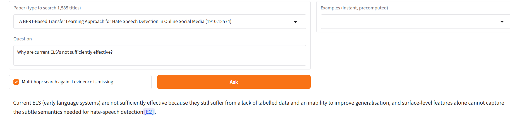

# Agentic Research & Evidence Synthesis Engine — report

Vanshika · October 2026 · code: this repository · answers: [results explorer](https://huggingface.co/spaces/Vanshika-0111/research-evidence-engine)

## Summary

The system answers questions about NLP research papers and cites a retrieved passage for every claim. On held-out
QASPER data the retrieval pipeline finds **79.5%** of the gold evidence in its top 5 passages (BM25: 61.2%), and the
LangGraph agent's citations support their sentences **95.6%** of the time by an LLM judge (72.6% when only QASPER's
single annotated paragraph counts), with **96.9%** faithfulness and **83%** answer correctness on 100 test
questions at about 3k tokens per question. A cross-paper agent finds 84% of the required papers for 19 hand-labelled
multi-paper questions, and 98% of the papers it cites are correct. A multi-hop extension was built and ablated: it
did not help. The judge was validated against a judge from a second model family. All answers are published with
their verdicts so every number can be checked.

## 1. Data

**QASPER v0.3**: 1,585 NLP papers with questions written by readers of the abstract and answers + evidence paragraphs
annotated by NLP practitioners. Papers are split into **28,541 section-aware chunks** (paragraphs grouped within a
section, section title kept as a prefix) and every annotated evidence paragraph is mapped to the chunk IDs that
contain it. Questions whose gold evidence is only in tables or figures (not in the text) have no gold chunk and are
dropped from retrieval metrics: 887 dev and 1,309 test questions remain.

**Cross-paper questions.** QASPER questions always belong to one paper, so 19 questions that need several papers
were written and labelled by hand before any cross-paper system was built (`eval/cross_paper_questions.jsonl`): 10
about a dataset ("Which papers run experiments on HotpotQA, and what does each propose?" — required = the paper's
own sections show experiments on it) and 9 about a topic (sarcasm, code-switching, question generation, fake news …
— required = main subject in title/abstract). 145 required papers in total; "acceptable" papers are not penalised.

## 2. Method

**Retrieval** (`retrieval/`). BM25 and bge-small-en-v1.5 each return 50 candidates within the paper; reciprocal
rank fusion (k=60) merges them; bge-reranker-v2-m3 re-scores the top 30 (fp16 on GPU); abstract chunks are then
removed. Corpus-wide dense search uses a FAISS index (IndexFlatIP, verified exact against numpy on 2,196 questions;
HNSW gives 7.4× faster search at 98% ANN recall@10).

**One-paper agent** (`agent/graph.py`, LangGraph). `decompose` asks gpt-oss-120b (Groq, low reasoning effort) for
up to 3 search queries as JSON; `retrieve` puts the question's own top 5 passages first and fills up to 7 with
sub-query results fused by RRF (the *anchored merge*: plain fusion of all queries had pushed gold passages out,
dropping evidence recall from 0.98 to 0.88 on dev); `answer` writes 1–4 sentences from the evidence only, with
`[E#]` after every claim, or a fixed decline sentence. Citation labels are parsed (including the `【E2†L3】` style
gpt-oss produces) and mapped back to chunk IDs.

**Cross-paper agent** (`agent/cross_paper.py`). `retrieve_papers`: BM25 + FAISS over all chunks (200 each), RRF,
cross-encoder over the top 100, papers ranked by their best chunk, top 10 papers × 2 passages. `synthesize`: one
bullet per relevant paper, cited, plus an optional cited comparison.

**Multi-hop agent** (`agent/multihop.py`). The one-paper graph plus a `check` node (is the evidence enough? if not,
one follow-up query in the paper's terms) and a `follow_up` node that adds up to 3 new passages; a conditional edge
loops back to `check` while hops remain (1 by default).

**LLM judge** (`eval/judge_agent_eval.py`, `eval/judge_cross_paper.py`). gpt-oss-20b (a different model and daily
quota from the agent) reads the question, the references, the answer and the full text of every cited passage and
returns JSON: per citation yes/partly/no, faithful, correct (cross-paper: per-paper support instead of
correctness). Scores: yes 1, partly 0.5, no 0.

## 3. Evaluation design

* **Dev for choices, test once.** Retrieval settings and agent prompts were chosen on dev (887 / 50 questions). The
  agent was frozen (anchor_k 5, 7 passages, prompts, model) before a single 100-question test run (seed 0).
* **Strict and judged citation metrics, always together.** Strict precision counts a citation only if it is
  QASPER's annotated paragraph. A manual review of the dev misses showed most were valid support from another
  paragraph, so the judged metric is the headline and strict is reported next to it.
* **Reference-quality filter.** A mechanical rule, fixed before the test run, excludes questions whose references
  only point elsewhere ("BIBREF9 ; BIBREF8", "Answer with content missing"); full and filtered numbers are both
  reported (3 of 50 dev and 0 of 100 test questions excluded).
* **Judge validation.** Section 4.3.
* **Resumable, token-budgeted runs.** The free Groq tier allows ~200k tokens per day per model; every evaluation
  writes one row at a time, stops cleanly at the daily limit and continues with `--resume`.

## 4. Results

### 4.1 Retrieval

| system | dev R@5 | test R@5 | test R@10 | test MRR@10 |
|---|---|---|---|---|
| BM25 | 0.628 | 0.612 | 0.849 | 0.455 |
| dense | 0.711 | 0.699 | 0.890 | 0.581 |
| hybrid RRF | 0.710 | 0.692 | 0.896 | 0.557 |
| + bge-reranker-v2-m3 | 0.748 | 0.749 | 0.932 | 0.588 |
| + abstracts excluded (final) | 0.793 | **0.795** | **0.941** | **0.677** |

Within a paper dense beats BM25; across the whole corpus BM25 beats dense and hybrid is best, which is why hybrid
was kept although it ties dense within a paper. The abstract finding is the largest single gain: no gold evidence is
in an abstract, but the reranker put an abstract first for 31% of questions.

### 4.2 One-paper agent

| metric (judge gpt-oss-20b) | test n=100 | dev n=50 |
|---|---|---|
| citation accuracy, judged | **0.956** | 0.879 |
| citation precision, strict | 0.726 | 0.628 |
| faithfulness | **0.969** | 0.878 |
| answer correctness (all / answered) | **0.830** / 0.856 | 0.680 / 0.756 |
| evidence recall (7 passages) / plain search k=7 | 0.848 / 0.846 | 0.912 / 0.905 |
| declined | 0.03 | 0.10 |
| tokens per question | 2,826 + 181 | 2,884 + 186 |

Test is above dev on most metrics; with ±6 points of sampling error on 50 questions and the ±10-point run-to-run
noise measured in 4.5, that is variation, not tuning (nothing was changed after the test run).

### 4.3 Is the judge trustworthy?

The judge shares a model family with the agent. A second judge, Gemini 3.6 Flash, graded the same 50 dev answers:

| verdict | items | exact agreement | Cohen's κ | lenient (yes/partly vs no) |
|---|---|---|---|---|
| correct | 45 | 0.822 | 0.498 | 0.889 |
| faithful | 45 | 0.822 | 0.151 | 0.933 |
| citations | 72 | 0.819 | 0.037 | 0.889 |

κ is low for faithfulness and citations because "yes" is ~90% of verdicts (κ's prevalence problem); exact and
lenient agreement are the informative numbers there. In 14 of 15 disagreements gpt-oss-20b was **stricter**, and on
the 8 with an independent manual verdict it matched the human on 6. The same-family worry is therefore not
supported, and the stricter judge is used for every headline number (Gemini: citation 0.978, faithfulness 0.978,
correctness 0.78 on dev).

### 4.4 Cross-paper

Paper recall@10 over the 19 questions: BM25 0.713, dense 0.725, hybrid 0.735, **hybrid + cross-encoder 0.840**
(recall@20 0.959, MRR 0.974). BM25 wins on dataset questions (exact names), dense on topic questions (paraphrases);
the reranker is at least as good as hybrid on 18 of 19 questions (it
loses on one broad gender-bias question).

| agent (judge gpt-oss-20b) | v1 | v2 (not held out) |
|---|---|---|
| required papers cited / shown | 0.634 / 0.840 | 0.657 / 0.840 |
| cited papers correct | 0.984 | 0.979 |
| citation support | 0.910 | 0.990 |
| faithfulness | 0.816 | 0.816 |

### 4.5 Multi-hop ablation (dev, same 50 questions)

| | single pass | multi-hop |
|---|---|---|
| evidence recall | 0.912 | 0.925 |
| citation support / faithfulness | 0.879 / 0.878 | 0.897 / 0.880 |
| answer correctness | 0.680 | 0.770 |
| agent tokens / question · seconds | 3,070 · 18.2 | 4,485 · 28.5 |
| questions that searched again | – | 40% |

The +9 points in correctness look like a win but are not caused by the hop: none of the 20 hopped answers cites a
passage found by the follow-up search, recall on hopped questions is identical before and after the hop, and
correctness rose more on the 30 questions that never searched again (0.767 → 0.867) than on the 20 that did
(0.550 → 0.625). On the non-hopped questions the pipeline is the frozen one, so that change is pure regeneration
noise: **about ±10 points of answer correctness at n=50**. Conclusion: no measurable gain at +46% tokens; the
single-pass agent stays the default. The check mostly fired when first-pass recall was already complete, asking
for details the paper does not contain ([H31](https://vanshika-0111-research-evidence-engine.static.hf.space/#multihop/H31):
the number of EEG electrodes); on the one real vocabulary-gap miss
([H30](https://vanshika-0111-research-evidence-engine.static.hf.space/#multihop/H30): "what datasets?" vs a paper
that "collected … questions") the follow-up query reworded the question instead of using the paper's terms.

### 4.6 Token efficiency

| system | LLM calls / q | agent tokens / q | judge tokens / q | agent tokens per correct answer |
|---|---|---|---|---|
| one-paper agent (test, n=100) | 2 | 3,007 | 1,208 | 3,623 |
| multi-hop agent (dev, n=50) | 3 | 4,485 | 1,275 | 5,825 (single pass on the same questions: 4,515) |
| cross-paper agent v2 (19) | 1 | 4,909 | 2,653 | – |

Short `[E#]` labels instead of chunk IDs, previews capped at 1,000 characters in cross-paper mode and low
reasoning effort keep prompts small; most of the prompt is the evidence itself (`results/token_efficiency.md`).

### 4.7 Deployment trade-off

On a 2-core CPU (a free cloud host) bge-reranker-v2-m3 needs 105 s to rerank one question's 30 passages. Measured
alternatives (dev Recall@5 on GPU, CPU time for 30 passages): MiniLM-L-6 0.770 in 3.9 s, MiniLM-L-12 0.776 in 7.7 s,
bge-reranker-base at 256 tokens 0.691 in 13.8 s (worse than no reranker, 0.747). MiniLM-L-6 keeps 97% of the
quality at ~27× lower latency and is the CPU setting of the app; reported results stay with v2-m3 on GPU.

## 5. Error analysis

**Test answers judged not fully correct or faithful: 20 of 100** (17 answered + 3 declined) — each links to the answer, its passages and verdicts:

| type | answers |
|---|---|
| incomplete lists | [T13](https://vanshika-0111-research-evidence-engine.static.hf.space/#paper/T13), [T27](https://vanshika-0111-research-evidence-engine.static.hf.space/#paper/T27), [T39](https://vanshika-0111-research-evidence-engine.static.hf.space/#paper/T39), [T49](https://vanshika-0111-research-evidence-engine.static.hf.space/#paper/T49), [T77](https://vanshika-0111-research-evidence-engine.static.hf.space/#paper/T77), [T79](https://vanshika-0111-research-evidence-engine.static.hf.space/#paper/T79), [T91](https://vanshika-0111-research-evidence-engine.static.hf.space/#paper/T91) |
| answers a different reading of the question | [T6](https://vanshika-0111-research-evidence-engine.static.hf.space/#paper/T6), [T19](https://vanshika-0111-research-evidence-engine.static.hf.space/#paper/T19), [T22](https://vanshika-0111-research-evidence-engine.static.hf.space/#paper/T22), [T80](https://vanshika-0111-research-evidence-engine.static.hf.space/#paper/T80) |
| wrong number vs the reference | [T24](https://vanshika-0111-research-evidence-engine.static.hf.space/#paper/T24) "14% error reduction" vs 0.008 F1; [T56](https://vanshika-0111-research-evidence-engine.static.hf.space/#paper/T56) layer count |
| claim not in the cited passage | [T8](https://vanshika-0111-research-evidence-engine.static.hf.space/#paper/T8) (faithful = no) |
| misstated comparison / unsupported second citation | [T62](https://vanshika-0111-research-evidence-engine.static.hf.space/#paper/T62), [T87](https://vanshika-0111-research-evidence-engine.static.hf.space/#paper/T87) |
| too generic ("a machine-learning model") | [T84](https://vanshika-0111-research-evidence-engine.static.hf.space/#paper/T84) |
| declined | [T17](https://vanshika-0111-research-evidence-engine.static.hf.space/#paper/T17), [T33](https://vanshika-0111-research-evidence-engine.static.hf.space/#paper/T33), [T71](https://vanshika-0111-research-evidence-engine.static.hf.space/#paper/T71) |

The dominant agent error is **incomplete lists** (7 of 17): the model answers with the first items it finds rather
than all items the evidence supports. The judge is not error-free either: on [T39](https://vanshika-0111-research-evidence-engine.static.hf.space/#paper/T39)
it lists "MRPC" as an unsupported claim although the answer never mentions MRPC (the answer's real flaw is the
opposite: MRPC is missing). On dev, about half of the "wrong" answers were dataset artefacts (references that only
say "BIBREF7", answers in tables), which motivated the reference-quality filter.

**Cross-paper: a brevity bias.** Of the 31 required papers v1 was shown but did not cite, about 23 had passages that
plainly show the dataset or topic, and 8 of 19 answers stopped at exactly five papers. In
[XP01](https://vanshika-0111-research-evidence-engine.static.hf.space/#corpus/XP01) (HotpotQA) the benchmarking-capacity
paper is required but unused, and the judge rejects the Propagate-Selector bullet. A stricter prompt (v2) stopped
claims taken from paper titles but not the skipping: the fix is structural (one relevance call per paper, then
aggregate).

**A judge bug found by reading verdicts.** A cross-paper judge reply that gave a verdict for only 1 of 8 cited
labels was scored on that one label (citation support 1.00 instead of 0.12). Missing verdicts now trigger one retry
and then count as a judge error; the fix is unit-tested and the within-paper test run was checked to be unaffected
(0 such answers).

**Premise mismatch (not measured).** Asked "Why are current ELS's not sufficiently effective?" about a hate-speech
paper that never mentions ELS (the acronym belongs to another paper), the agent expanded it as "early language
systems" and cited a real but unrelated sentence instead of declining:

QASPER never asks a question about the wrong paper, so the decline rate under false premises is unknown. A small
robustness set (questions paired with a wrong paper) and a premise check before answering are the next steps.

## 6. Limitations

* Judge-based metrics carry the judge's error; the second-family comparison and manual checks bound it.
* 50-question dev comparisons have ±6 points sampling error and ±10 points run-to-run noise; only large effects
  are interpreted.
* The cross-paper set is small and hand-labelled by one person; v2 of its prompt is not held out.
* Test latency is not reported (part of the run used a CPU); per-question time is dominated by API pacing.
* The free Hugging Face tier no longer hosts Gradio apps, so the public Space shows saved results; the live app runs
  in Colab or on a paid Space.

## 7. Future work

Per-paper map-reduce synthesis for cross-paper questions; a premise check and a wrong-paper robustness set; list
completeness prompting or a verifier pass for "which X" questions; evaluating the multi-hop check only when
first-pass retrieval confidence is low.

## Reproducibility

Every number above comes from a file in `results/` (agent and judge outputs per question, summary JSONs, judge
agreement report, token report, CPU benchmark). The Colab notebooks in `notebooks/` record each step with a
WHAT/WHY note per cell; the commands are in the README. 66 tests run in CI on every push.
